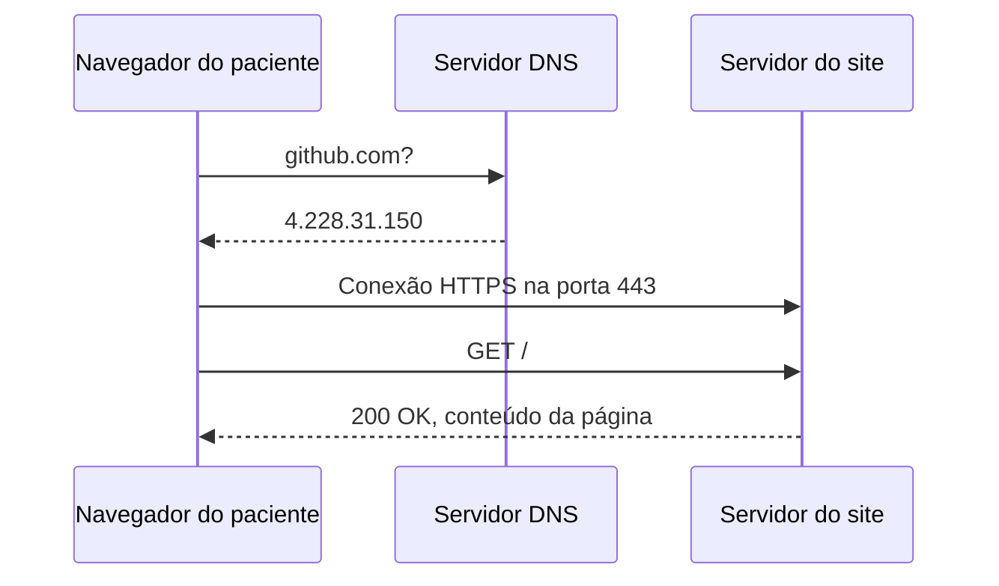

# Arquitetura da Clínica Vida+

## O caminho de uma requisição



## Evidência do DNS

Comando executado: `nslookup github.com`

```text
Servidor:  ns3.uninove.br
Address:   186.251.39.123

Não é resposta autoritativa:
Nome:      github.com
Address:   4.228.31.150
```

Comando executado: `ping github.com`

```text
Disparando github.com [4.228.31.150] com 32 bytes de dados:
Resposta de 4.228.31.150: bytes=32 tempo=9ms TTL=112
Resposta de 4.228.31.150: bytes=32 tempo=9ms TTL=112
Resposta de 4.228.31.150: bytes=32 tempo=6ms TTL=112
Resposta de 4.228.31.150: bytes=32 tempo=8ms TTL=112

Pacotes: Enviados = 4, Recebidos = 4, Perdidos = 0 (0% de perda).
```

## Evidência do HTTP

As requisições foram observadas na aba Network do DevTools do Chrome.

| Recurso | Método | Status | Tipo |
|---|---|---|---|
| `javascript-123456789` | GET | 404 | Documento |
| `react-fa5e2e82e6e0ecc0.js` | GET | 200 | JavaScript |
| `react-compiler-runtime-4610b...` | GET | 200 | JavaScript |
| `light-3a3d2c708970e4e8.css` | GET | 200 | CSS |

O método GET deve ser confirmado nos cabeçalhos de cada requisição. Os nomes abreviados dos recursos devem ser substituídos pelos nomes completos que aparecem no DevTools.

## Por que o HTTPS é necessário?

O formulário de agendamento da Clínica Vida+ pode transmitir dados pessoais, como nome completo, telefone e informações sobre a consulta. O HTTPS protege os dados durante a transmissão entre o navegador e o servidor por meio de criptografia. Isso reduz o risco de interceptação ou alteração das informações. Por isso, a clínica deve utilizar HTTPS para proteger a privacidade dos pacientes e aumentar a confiança no serviço.